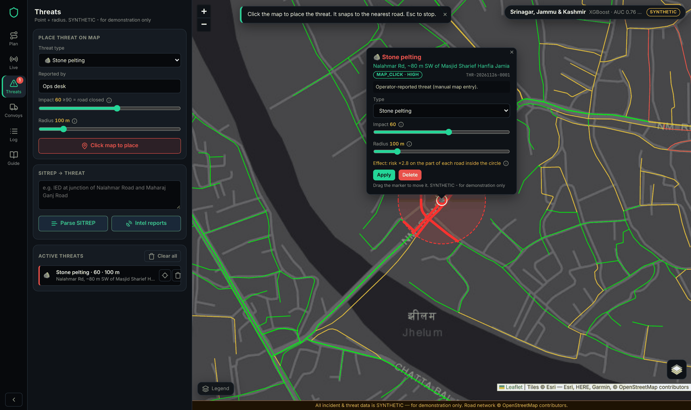
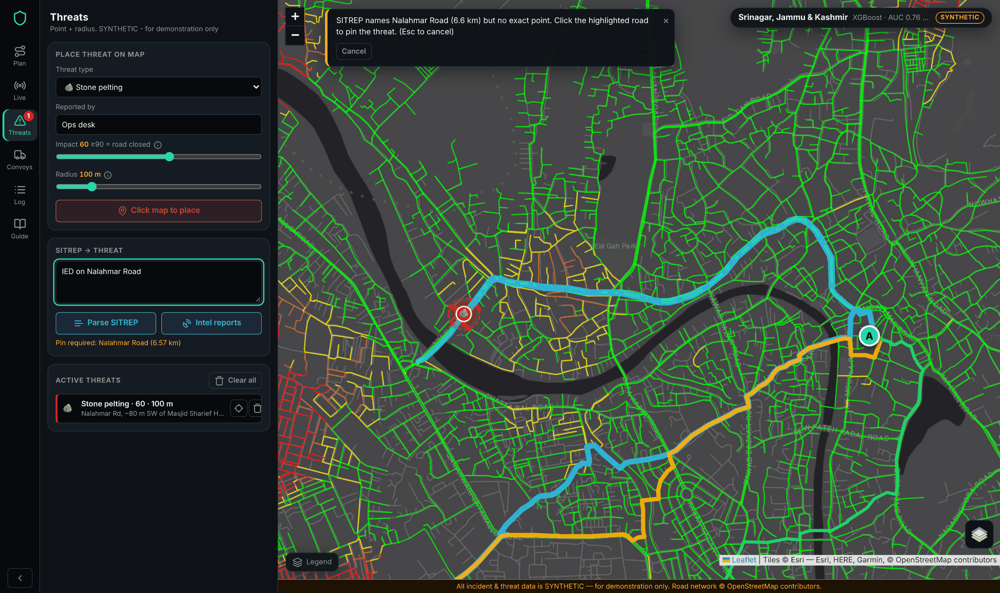
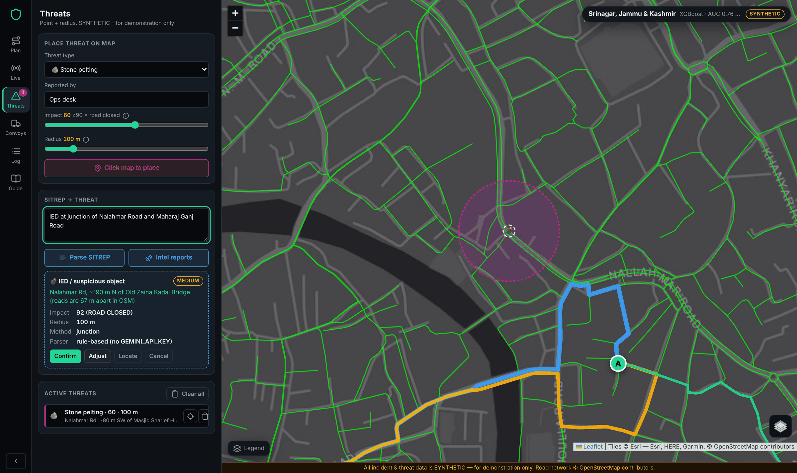
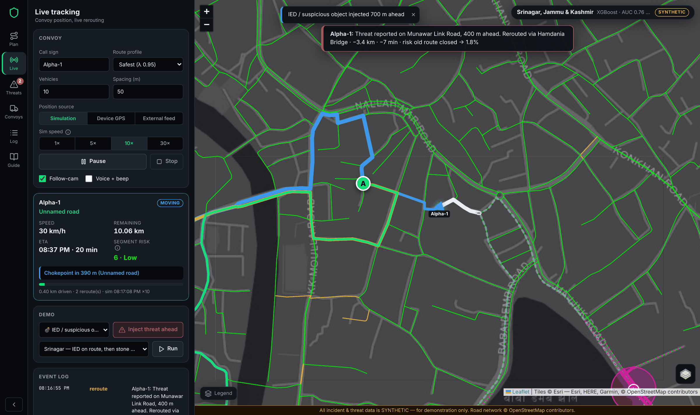
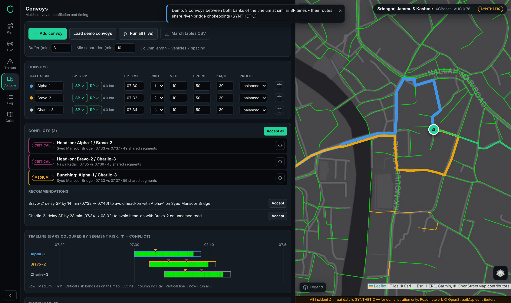
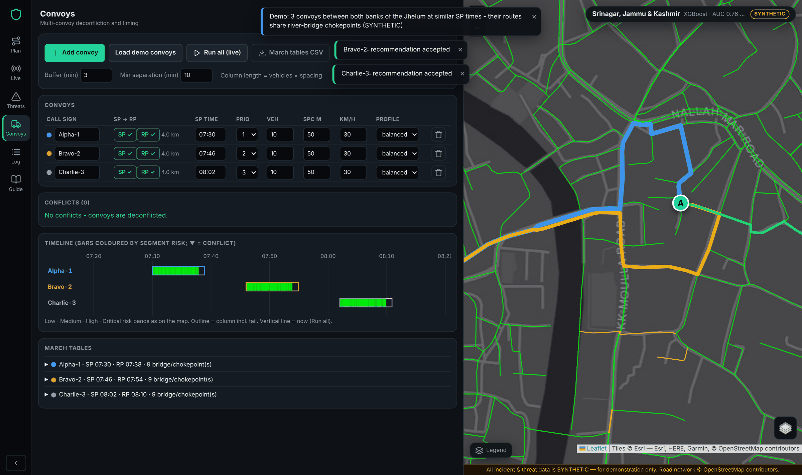
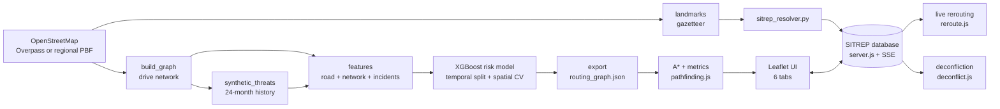

# SANCHAR

**Smart AI Navigation for Convoy Hazard Avoidance & Rerouting**

*Sanchar* (संचार) means "movement". SANCHAR is an AI-based safest route planner for military convoys.

> ⚠️ **All incident and threat data in this project is SYNTHETIC, for demonstration only.**
> It contains no real security data, real units, real people or operational details.

SANCHAR is a web app for planning and running road-convoy movements over the real OpenStreetMap road
network of **Srinagar, Jammu & Kashmir** (24,574 intersections, 29,078 road segments).
Designed and built by our team with the help of **Claude Code**.

* An **ML model** (XGBoost) gives every road segment a threat score from incident history and
  convoy-relevant road factors (bridges, chokepoints, narrow or unpaved roads, settlement density).
* A* plans **Fastest / Balanced / Safest** routes and reports convoy metrics.
* Operators add **live threats** as a precise point with a small radius: by clicking the map,
  from an intel feed, or from a free-text **SITREP** resolved against an offline OSM gazetteer.
  Every threat is stored in a persistent **SITREP database**.
* A **Live** view moves convoys (simulation, device GPS or an external tracker feed) and
  **reroutes them on the move**, Google-Maps style, when a threat appears ahead.
* A **Convoys** planner **deconflicts several convoys** (head-on on bridges, bunching,
  junctions, shared threats) and recommends start-point (SP) times.
* A **Guide** explains every number in plain language.


---

## 1. Quick start

```bash
pip install -r requirements.txt
python -m pipeline.run_all          # road network + synthetic threats + ML model + export (~2 min)
node server.js                      # http://localhost:3000
pytest -q                           # Python tests (pipeline, SITREP resolver, JS suite)
npm test                            # JS tests (A*, threat geometry, API, rerouting, deconfliction)
```

* The server uses **Node built-ins only** (no `npm install` needed). The frontend is plain JS
  plus Leaflet from a CDN, with no build step.
* The first `run_all` downloads OSM data, then works offline from `data/cache/`. Sources, in order:
  1. the Overpass API via OSMnx;
  2. the regional extract `OSM_EXTRACT_URL` (Jammu & Kashmir `.osm.pbf` from openstreetmap.fr,
     27 MB), clipped with `osmium`.

  If neither source is reachable, the pipeline stops with a clear message.
* To change the operating area, edit `REGION_NAME / CENTER / RADIUS_M / OSM_EXTRACT_URL` in
  `pipeline/config.py`, delete `data/cache/` and re-run. The frontend reads everything from
  `routing_graph.json`.
* Optional: put `GEMINI_API_KEY=...` in `.env` and `pip install google-genai` to let Gemini extract
  SITREP fields. The demo never depends on it; the offline parser is always available.

### Seeing an old version?
1. **Get the latest code** in your project folder: `git pull`, then check that `git log -1 --oneline`
   shows the latest commit.
2. **Stop any old server.** Close every terminal running `node server.js`, or free the port on Windows:
   `netstat -ano | findstr :3000` and then `taskkill /PID <number> /F`. If another server holds
   the port, a new one prints *"Port 3000 is already in use"* and exits.
3. Start `node server.js`. The first line must read **`SANCHAR v2.0.0 · …`**
   (`http://localhost:3000/healthz` also shows the version).
4. Reload the page with **Ctrl + F5** (or open a private window) once, so the browser drops old cached files.
   From v2.0.0 on, every script is versioned, so this should not be needed again.

### Windows notes
* `server.js` runs `python` on Windows and `python3` elsewhere (override with `PYTHON=...`).
* **Python 3.12 is recommended.** If `pip install` fails building geo wheels (`pyproj`, `shapely`,
  `osmium`, `geopandas`) on a very new Python such as 3.14, create a 3.12 virtual environment:
  `py -3.12 -m venv .venv && .venv\Scripts\activate`.
* Every Python file read and write uses `encoding="utf-8"` (CSV also uses `newline=""`). This fixes
  `UnicodeEncodeError: 'charmap' codec can't encode characters` on Windows. Python is spawned
  with `PYTHONIOENCODING=utf-8`.
* The CSV exports include a UTF-8 BOM, so Excel shows place names correctly.

## 2. Deploy SANCHAR on Render (free)

SANCHAR ships with a `Dockerfile`, `.dockerignore` and a Render Blueprint (`render.yaml`). The
data pipeline does **not** run on the server: its outputs are already in the repo, so the image
contains only Node (the server) and the Python standard library (SITREP parsing). It builds in
seconds, is about 400 MB, and starts in under a second.

1. **Push the latest code to GitHub.** In a terminal in the project folder:
   ```bash
   git add .
   ```
   ```bash
   git commit -m "Update SANCHAR"
   ```
   ```bash
   git push
   ```
2. Go to **[render.com](https://render.com)** and **sign up with GitHub**. When asked, allow Render to access this repository.
3. Click **New + → Blueprint**, choose the repository, and Render reads `render.yaml`. Click **Apply**.
4. Wait for the first build (a few minutes). The app opens at `https://sanchar.onrender.com`
   (or `https://sanchar-xxxx.onrender.com` if that name is taken).
5. Optional: in the service's **Environment** tab, set `GEMINI_API_KEY` to let Gemini extract SITREP
   fields. Without it the offline parser is used, and everything still works.
6. From now on, every `git push` to the deployed branch redeploys automatically.

**Known limits of the free tier**
* The service **sleeps after 15 minutes without visitors**, and the first visit after that takes about a minute.
  **Open the link 2 minutes before any review or demo.**
* The filesystem is temporary: threats, SITREPs and convoys saved at runtime **reset** when it sleeps
  or redeploys. The demo intel reports are re-seeded automatically on every start. (The database
  path can be changed with the `SITREP_DB` environment variable.)
* For an always-on version, upgrade the service to a paid instance in the Render settings.

**What makes it fast on a small instance:** the two big data files are served **gzip-compressed**
(routing graph 21.6 MB → 2.5 MB, road geometry 17.7 MB → 2.2 MB), compressed once and kept in memory,
with `ETag` / `304 Not Modified` and an hour of browser caching. `GET /healthz` is the health check.
Only an allowlist of public files is served; server code, `.env` and databases never are.

**Test the container on your own machine** (requires Docker Desktop):
```bash
docker build -t sanchar .
```
```bash
docker run --rm -p 3000:10000 sanchar
```
Open http://localhost:3000, plan a route, place a threat and parse a SITREP. Check compression and health:
```bash
curl -sI -H "Accept-Encoding: gzip" http://localhost:3000/routing_graph.json
```
```bash
curl -s http://localhost:3000/healthz
```

**Backup for presentations:** run it locally (`node server.js`) and share it for the session with
`cloudflared tunnel --url http://localhost:3000` or `ngrok http 3000`.

## 3. The six tabs (keys 1–6, Esc cancels any click mode)

| Tab | What it does |
|---|---|
| **Plan** | Click start A and destination B. Fastest (λ 0) · Balanced (λ 0.6, slider) · Safest (λ 0.95) appear with a side-by-side metrics table. "Preview drive" or "Start live". |
| **Live** | Run the convoy (sim 1×/5×/10×/30×, pause; device GPS; external feed). HUD shows road, speed, remaining distance, ETA, segment risk, next hazard and progress. Follow-cam, event log, voice/beep. "Inject threat ahead", scenario picker. |
| **Threats** | Place a threat on the map (type, impact, radius, reported by), parse a SITREP, activate intel reports, list active threats (locate / clear). |
| **Convoys** | Several convoys with SP/RP, SP time, priority, vehicles, spacing, speed and profile. Conflicts, recommendations (Accept / Accept all), Gantt timeline, march tables (CSV), Run all. |
| **Log** | The SITREP database: sortable and filterable table with search, CSV export, Locate / Edit / Clear, expandable SITREP line and history, plus live events (reroutes, arrivals). |
| **Guide** | Plain-language meaning of segment risk, threat impact, multiplier, λ and route metrics. Every number in the UI has an ⓘ tooltip linking here. |

## 4. Threats: point + small radius

* **Model:** every threat, whatever its source, is `{id, lat, lon, radius_m, type, impact,
  location_label, resolution, confidence, source, created_at, expires_at, status, ...}`.
* **Per-type defaults** live in one file, `threat_types.json`:

  | Type | Impact | Radius | Expires |
  |---|---|---|---|
  | IED / suspicious object | 92 (road closed) | 100 m | until cleared |
  | Ambush risk | 80 | 150 m | 6 h |
  | Stone pelting | 60 | 100 m | 4 h |
  | Road blockade | 70 | 50 m | 8 h |
  | Landslide | 95 (road closed) | 50 m | until cleared |
  | Accident / obstruction | 45 | 30 m | 2 h |

* The radius slider runs from 25 to 500 m. **The circle drawn is exactly the radius used for routing.** Click a threat to
  edit its type, impact or radius, drag it to move it, or delete it.
* **Map clicks snap to the nearest road** (perpendicular projection, 250 m spatial grid). A dashed
  line shows snaps over 10 m. With no road within 150 m, the operator is asked before placing off-road.
* **Only the part of a road inside the circle is affected:**
  * soft threats (impact < 90): `w_eff = w(1 − f_in) + max(w, impact)(1 + 3·impact/100)·f_in`,
    where `f_in` = fraction of the edge inside the circle;
  * hard block (impact ≥ 90): the whole junction-to-junction link is closed (a convoy must drive
    it end to end).

  The map paints only the clipped part red or magenta, with a thin dashed line for closed links.



## 5. SITREP → threat (never guesses)

`POST /parse-sitrep` resolves the location **offline** against OSM roads and
`data/landmarks.json` (1,806 named OSM features: bridges, chowks, police stations, hospitals,
markets, religious sites, schools…). The first rule that matches wins:

| # | Rule | Example | Result |
|---|---|---|---|
| 1 | Coordinates | `34.0812, 74.7956` · `34°05'01"N 74°47'50"E` · `43S DT 81299 71455` (MGRS) | exact point · high |
| 2 | Junction of two roads | `IED at junction of Nalahmar Road and Maharaj Ganj Road` · `X / Y crossing` · `where X meets Y` | shared node · high (medium if OSM has a gap) |
| 3 | Landmark | `Road blockade near Lal Chowk` · `near Nawa Kadal` | landmark snapped to road |
| 4 | Landmark/junction + offset | `Ambush risk 300 m east of Nawa Kadal on Nalahmar Road` | walked 300 m **along** the road |
| 5 | Road only | `IED on Nalahmar Road` | **no point placed**: the road pulses cyan; click it within 60 m to pin (Esc cancels) |
| 6 | Nothing | `Something happened somewhere` | error listing the accepted formats |

A resolved SITREP first shows a **preview card** (type, impact, radius, location, method,
confidence badge) with a draggable dashed marker: **Confirm**, **Adjust** or **Cancel**. Gemini
(optional) only extracts fields; it is never trusted for coordinates.

| Pin mode | Junction preview |
|---|---|
|  |  |

## 6. Live tracking and on-the-move rerouting

* **Position sources:** simulation (default), device GPS (`watchPosition`, map-matched to the road,
  outside the operating area → warning and fall back to simulation), or an **external feed**:

  ```bash
  curl -X POST http://localhost:3000/api/convoys/LIVE1/position -H "Content-Type: application/json" -d "{\"lat\":34.08,\"lon\":74.80,\"speed_kmph\":28}"
  ```

  The server rebroadcasts the fix over SSE, and the Live tab follows it when "External feed" is selected.
* **Rerouting rules** (`js/reroute.js`), checked on every threat change (from this tab, another tab
  or another client) and every 10 s of sim time:
  * **Mandatory:** a remaining edge is closed → replan from the next node. If the closure is
    ahead on the current segment, **TURN BACK** and replan from the previous node.
  * **Advisory:** remaining risk cost up by more than 15% → switch automatically if the
    alternative is at least 10% cheaper, otherwise show "Alternative available … [Accept] [Ignore]".
  * **Hysteresis:** at most one automatic advisory reroute per 30 s, and never back to a route
    abandoned in the last 2 min. Mandatory reroutes ignore the 30 s limit (safety).
* **Feedback:** the old route fades out as a grey dashed line while the new one draws on. A banner
  reads, for example, *"Threat reported on Munawar Link Road, 400 m ahead. Rerouted via Hamdania
  Bridge · … · risk … → 1.8%"*. Events are written to the SITREP database.
* **Demo:** "Inject threat ahead" drops a threat 500–1000 m ahead on the current route.
  **Scenarios** (`data/scenarios/*.json`) are timed scripts:

  ```json
  {"name": "...", "start": {"lat": 34.093, "lon": 74.8095}, "end": {"lat": 34.065, "lon": 74.7415},
   "profile": "safest", "speed_mult": 10,
   "steps": [{"at_s": 60, "action": "add_threat", "ahead_m": 700, "type": "IED", "radius_m": 100},
             {"at_s": 150, "action": "add_threat", "lat": 34.08, "lon": 74.79, "type": "stone_pelting"}]}
  ```

  Actions: `add_threat` (`lat`/`lon`, or `ahead_m` on the convoy's current route), `clear_threats`,
  `set_speed`, `note`. One scenario is included: *Srinagar, IED on route, then stone pelting on the alternative*.



## 7. Multi-convoy deconfliction

* **Occupancy:** the head enters an edge at `t_in`; the tail leaves `column / speed` after the head
  exits (column = vehicles × spacing). Window = `[t_in − 3 min, t_out + 3 min]`; junctions likewise.
* **Conflicts:**

  | Conflict | Rule | Severity |
  |---|---|---|
  | Head-on | same edge, opposite directions, overlapping windows | **Critical** on bridge / chokepoint / narrow / unpaved, else High |
  | Bunching | same edge, same direction, gap < 10 min | Medium |
  | Junction crossing | same node, overlapping windows | Medium |
  | Shared threat exposure | both inside the same threat radius at the same time | High |

  Consecutive shared segments are grouped into one conflict per pair.
* **Resolution:** order by priority, then SP. Each lower-priority convoy tries SP delays (2-min
  steps up to 60 min) and an alternative route that avoids reserved edges, keeping the lowest
  combined cost. These are shown as **recommendations**, e.g. *"Bravo-2: delay SP by 14 min
  (07:32 → 07:46) to avoid head-on with Alpha-1 on Syed Mansoor Bridge"* [Accept] [Accept all].
* **Outputs:** Gantt timeline (bars coloured by segment risk, conflict markers, live "now" line),
  march tables (SP, every bridge or chokepoint with its ETA, RP) with CSV export, routes and
  conflict markers on the map. **Run all** starts every convoy from its SP in the live engine,
  and conflicts are re-checked after any reroute.
* **Try it:** Convoys tab → *Load demo convoys* → 2 Critical head-ons + 1 bunching → *Accept all*
  → 0 conflicts and the bars separate on the Gantt.

| Conflicts | Resolved |
|---|---|
|  |  |

## 8. Method



### 8.1 Road network
`ox.graph_from_point(CENTER, dist=12 km, network_type="drive")`, or the same "drive" filter
applied to the clipped regional extract, with OSMnx speeds and travel times added. The graph is converted to undirected (keeping the shortest parallel
edge), restricted to the largest connected component, and relabelled `0..N-1`. Each edge
keeps its length, road class, name, lanes, maxspeed, bridge/tunnel flags, surface and
geometry.

### 8.2 Synthetic incidents
`data/incidents.csv` holds a seeded (reproducible) 24-month history of
`IED / ambush / stone_pelting / road_blockade / landslide / accident` incidents, all placed
on real road edges:
* 10 hotspot clusters biased towards chokepoints, bridges, narrow or unpaved roads, dense
  settlements and winding (hill) sections. Hotspots are *persistent*, *fading* (stop before
  the label window) or *emerging* (start late), so the past does not perfectly predict the future.
* About 38% background incidents driven only by road factors.
* Hostile types are concentrated at night (20:00–05:00) and landslides in the monsoon (Jul–Sep).
* `data/live_threats.json` holds 5 "current" intel reports with fictional descriptions.

### 8.3 Features and ML risk model
**Temporal split to avoid leakage.** Features use incidents from months 1–18. The label is
whether any incident from months 19–24 falls within 150 m of the edge.

| Group | Features |
|---|---|
| Incident history | count within 250 m / 500 m / 1 km, severity-weighted density, distance to nearest incident, night share, hostile-type count, last-6-month count |
| Road / convoy | road-class priority, lanes, narrow, bridge, tunnel, unpaved, length, curviness (path ÷ straight-line) |
| Network | **chokepoint score** = edge betweenness (k = 500 samples), top 5% flagged; node degree; node density within 500 m |

The model is an XGBoost classifier (it falls back automatically to scikit-learn if
XGBoost is unavailable), evaluated on a stratified 75/25 split and compared against a
**baseline** that ranks edges by distance to the nearest past incident only.

The final model is refit on all labelled data and scores the latest 18-month window.
Edge risk = `p_incident × expected-severity factor`, scaled to the 0–100 `weight` used by
the map colours. The raw probability is stored as `risk_prob`.

### 8.4 Routing
A* with a binary heap and a cost where both terms are on the same scale:

```
cost = (1 − λ)·(length / L_ref) + λ·(weight / 100)·(length / L_ref)        L_ref = median edge length
h    = straight_line / L_ref · (1 − λ)                                      (admissible)
```

Risk is charged per metre, so a long risky road costs more than a short one.
**Fastest** uses λ = 0, **Balanced** λ = 0.6 (adjustable with a slider), **Safest** λ = 0.95.

**Route incident probability** uses the independent-Bernoulli model
`P = 1 − Π(1 − p_i)` (Krumm & Horvitz, *Risk-Aware Planning: Methods and Case Study for
Safer Driving Routes*, AAAI 2017). Here `p_i` is the per-traversal probability derived from
the model's 6-month probability via a Poisson rate and a 12-hour incident activity window.
Other metrics per route: distance, ETA at 30 km/h, mean and max segment risk, number of
high-risk segments, **exposure time** on segments with weight ≥ 60, chokepoints crossed,
and threat-zone segments.

### 8.5 Risk scales (see the Guide tab)
* **Segment risk 0–100** is *relative* (100 = top 1% of roads), not a probability.
  Bands: Low < 30 ≤ Medium < 60 ≤ High < 80 ≤ Critical.
* **Threat impact 10–100:** 90+ closes the road.
* **Multiplier ×(1 + 3·impact/100)** is how many times more dangerous a segment inside a threat
  counts. It is different from **λ**, which is a route preference: to avoid 1 km of risk-R road the
  planner accepts a detour of up to `1 + λ·(R/100)/(1 − λ)` km (λ 0.6 → 2.2 km for R = 80).

## 9. Files and API

| Layer | Files |
|---|---|
| Pipeline (Python) | `pipeline/config.py`, `build_graph.py`, `landmarks.py`, `synthetic_threats.py`, `features.py`, `train_model.py`, `export_graph.py`, `run_all.py` |
| SITREP | `sitrep_resolver.py` (offline resolver, MGRS / DMS), `gemini_api.py` (entry point, optional Gemini) |
| Server (Node built-ins) | `server.js` (allowlisted static files with gzip / ETag, API, SSE), `lib/store.js` (atomic JSON store), `lib/sitrep.js` (validation, DTG, SITREP line, CSV) |
| Deployment | `Dockerfile`, `.dockerignore`, `render.yaml` |
| Frontend | `index.html`, `style.css`, `app.js` (map, routing, shell), `pathfinding.js`, `js/threat-geo.js`, `js/threats.js`, `js/reroute.js`, `js/live.js`, `js/deconflict.js`, `js/convoys.js`, `js/log.js`, `js/guide.js`, `js/ui.js` |
| Shared config | `threat_types.json` |
| Data | `data/landmarks.json`, `data/live_threats.json`, `data/incidents.csv`, `data/scenarios/`, `data/sitrep_db.json` and `data/convoys.json` (runtime, git-ignored) |

| Method | Path | Purpose |
|---|---|---|
| GET | `/api/threats?status=&source=&type=` | list threat records |
| POST | `/api/threats` | create (validates type, impact 10–100, radius 25–500, inside the operating box) |
| PATCH | `/api/threats/:id` | edit / move / change radius / clear |
| DELETE | `/api/threats/:id` | soft delete (`status: cleared`, kept in history) |
| GET | `/api/threats/export.csv` | CSV export of the log |
| POST | `/api/intel/apply` | activate pending intel-feed records |
| GET / POST | `/api/events` | live event log (reroutes, arrivals…) |
| GET | `/api/stream` | Server-Sent Events: `threat_created/updated/cleared`, `event_logged`, `convoy_position`, `convoys_changed` |
| GET / POST / PATCH / DELETE | `/api/convoys[/:id]` | convoy definitions |
| POST | `/api/convoys/:id/position` | external position feed `{lat, lon, speed_kmph, heading, ts}` |
| GET | `/api/scenarios` | scenario list |
| POST | `/parse-sitrep` | `{text}` → `ok` / `needs_pin` / `error` |
| GET | `/fetch-live-threats` | intel-feed records in a compact format |
| GET | `/healthz` | health check `{status, name, uptime_s}` (used by Render) |

Manual threats get an auto-generated SITREP line using the military DTG, for example:
`SITREP 270145Z NOV 26 | TYPE: IED/SUSPICIOUS OBJECT | LOC: 34.08112N 74.79563E (Nalahmar Rd, ~120 m W of Nawa Kadal) | RADIUS: 100 m | IMPACT: 92 (ROAD CLOSED) | SRC: MANUAL MAP ENTRY | BY: Ops desk | STATUS: ACTIVE | SYNTHETIC`

## 10. Results

### 10.1 Risk model (`reports/metrics.json`, Srinagar, 29,078 edges, 16.5% positive)

| | ROC-AUC | PR-AUC | Precision | Recall |
|---|---|---|---|---|
| **XGBoost**, random stratified split | **0.936** | **0.794** | 0.72 | 0.74 |
| Baseline (nearest past incident), random split | 0.710 | 0.299 | 0.30 | 0.60 |
| **XGBoost**, spatial-block CV (1.5 km cells, 5 folds) | **0.76 ± 0.03** | | | |
| Baseline, spatial-block CV | 0.70 | | | |

Confusion matrix (validation, F1-optimal threshold): TN 5726 · FP 348 · FN 315 · TP 881.
**The spatial-block number is the honest one**, because the random split puts neighbouring
edges on both sides. The model beats the baseline in both settings.


### 10.2 Performance (measured in headless Chromium)

| Check | Target | Measured |
|---|---|---|
| Initial load (39 MB graph + geometry, localhost) | < 5 s | **1.9 s** |
| Three routes (Fastest / Balanced / Safest) | < 1 s | **52 ms** (first call incl. warm-up; later 10–35 ms) |
| Reroute from the convoy's position (A* from next node) | < 100 ms | **9.5 ms** (decision logic 0.2 ms) |
| Pan the 29k-segment risk layer | smooth | canvas renderer; ~50 ms/frame in *software-rendered* headless Chromium at 2× DPR. Expect much faster with a real GPU |

### 10.3 Screens (`reports/screens/`)
`1_risk_map` · `2_three_route_comparison` · `3_threat_small_radius` · `4_sitrep_pin_mode` ·
`5_sitrep_junction_preview` · `6_live_reroute` · `7_convoys_conflicts` · `8_convoys_gantt_resolved` ·
`9_sitrep_log` · `10_risk_guide`

## 11. Tests
* `pytest -q`: graph schema, string adjacency keys, weights 0–100, no NaN, model > baseline (random and
  spatial), synthetic labels, **SITREP resolver** (road-only → needs_pin, junction, landmark within
  150 m, decimal / DMS / MGRS, offset walked along the road), and it runs the JS suite.
* `npm test`: A* fixture, **threat geometry** (clip length, `f_in`, hard block, snapping), **threat API**
  (temp DB: create / list / patch / delete, validation, CSV, SSE), **static serving** (gzip, ETag/304,
  allowlist, traversal, `/healthz`), **rerouting** (next node, turn back,
  thresholds, hysteresis, abandoned routes), **deconfliction** (Critical head-on on a bridge,
  delay removes it, bunching, junction, shared threat, least-bad reroute).

## 12. Limitations
* **Synthetic data:** the generator encodes our assumptions about risky roads, so the model partly
  learns them back. Real use needs real incident feeds.
* Road-only: no off-road movement, terrain, elevation or line-of-sight. Hill roads are approximated
  by curviness.
* Static model with no time-of-day conditioning at query time. Live threats are applied by rule
  (fractional penalty / hard block), not learned.
* Independent-segment route probability (the Krumm & Horvitz simplification). Deconfliction
  assumes constant convoy speed.

## 13. Future work
Real incident feeds; DEM / terrain features; line-of-sight exposure; time-of-day and seasonal
models; k-diverse alternatives; learned threat impact; speed profiles by road class and gradient
for convoy timing.

## 14. Authors and acknowledgements
Designed and built by our team with the help of **Claude Code** (Anthropic's AI coding assistant),
which we used for implementation, testing and documentation.

Data, libraries and references:
* Road network and landmarks © OpenStreetMap contributors, available under the
  Open Database Licence (ODbL).
* Basemap tiles © Esri. Map rendering by Leaflet.
* Python stack: OSMnx, NetworkX, GeoPandas, Shapely, pyosmium, scikit-learn, XGBoost, pandas, NumPy,
  Matplotlib.
* The route incident probability follows J. Krumm and E. Horvitz, *Risk-Aware Planning: Methods
  and Case Study for Safer Driving Routes*, AAAI 2017.

Released under the MIT licence.
