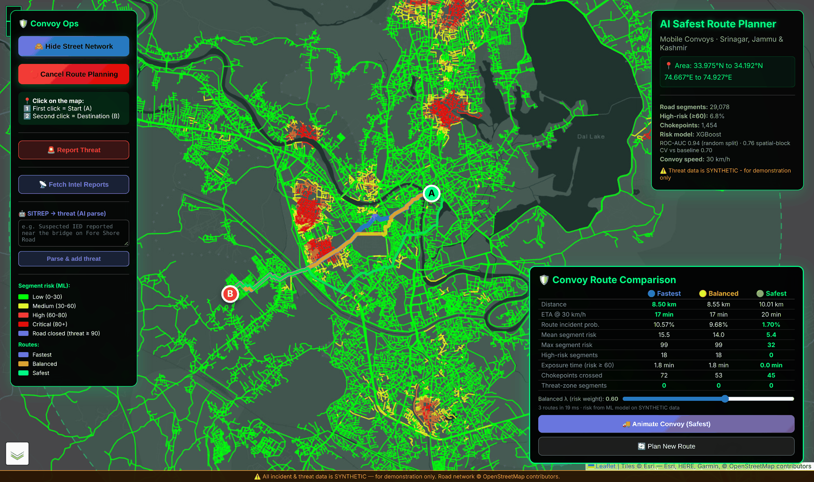
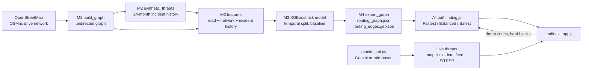
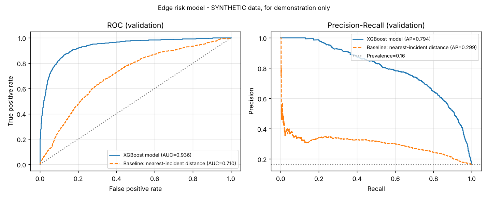

# AI-Based Safest Route Planner for Mobile Convoys

> ⚠️ **All incident and threat data in this project is SYNTHETIC, for demonstration only.**
> It contains no real security data, real units, real people or operational details.

A web app that plans **Fastest / Balanced / Safest** routes for a road convoy over a real
OpenStreetMap road network. Every road segment gets a **threat score** from a
**machine-learning model** (XGBoost) trained on incident history plus convoy-relevant road
factors. Operators can inject **live threat reports** by clicking the map, loading an intel
feed, or typing a free-text **SITREP** that is parsed by AI. The convoy then **re-routes**
automatically, and road closures are never crossed.

Operating area: **Srinagar, Jammu & Kashmir**. That's a 24 × 24 km box around the city
centre: old-city lanes, bridges over the Jhelum, Dal Lake shore roads, the national highway
and bypasses. The real OSM road network has 24,574 intersections and 29,078 road segments.
The area is set in one file, `pipeline/config.py`.



---

## 1. Problem statement

The shortest road route is often not the best route for a convoy. Narrow hill roads,
bridges, chokepoints that every route must pass through, and areas with repeated
incidents all add risk. A planner needs to:

1. quantify the risk of each road segment from past incidents and road characteristics,
2. trade travel time against threat exposure in an explainable way,
3. react to new threat reports by re-routing at once, and
4. report convoy-relevant metrics: ETA at convoy speed, route incident probability,
   time exposed to high-risk segments, and chokepoints crossed.

## 2. Architecture



| Layer | Files |
|---|---|
| Data pipeline (Python) | `pipeline/config.py`, `build_graph.py`, `synthetic_threats.py`, `features.py`, `train_model.py`, `export_graph.py`, `run_all.py` |
| Server (Node, no dependencies) | `server.js`: static files, `GET /fetch-live-threats`, `POST /parse-sitrep` |
| Frontend (plain JS + Leaflet from CDN) | `index.html`, `app.js`, `pathfinding.js`, `style.css` |
| SITREP parser | `gemini_api.py`: Gemini if `GEMINI_API_KEY` is set, otherwise an offline keyword parser plus OSM street-name lookup |
| Tests | `tests/test_pipeline.py` (pytest), `tests/test_astar.js` (Node) |

## 3. How to run

```bash
pip install -r requirements.txt
python -m pipeline.run_all          # build graph + synthetic threats + train model + export (~2-4 min)
node server.js                      # http://localhost:3000
pytest -q
```

* The first `run_all` gets the road network from OpenStreetMap and caches it in
  `data/cache/graph.graphml`. Later runs work offline. It tries these sources in order:
  1. the **Overpass API** via OSMnx;
  2. a **regional OSM extract** (`OSM_EXTRACT_URL`, by default the Jammu & Kashmir `.osm.pbf`
     from openstreetmap.fr, 27 MB), clipped to the operating box with `osmium` and loaded
     with OSMnx using the same "drive" road filter;
  3. if both fail, the bundled Toronto street extract in `legacy_toronto/`, with a clear warning.
     The UI then shows the region as *"Toronto (FALLBACK)"*.
* Change the area by editing `REGION_NAME / CENTER / RADIUS_M` (and `OSM_EXTRACT_URL` for the
  matching state) in `pipeline/config.py`, deleting `data/cache/`, and re-running `run_all`. The frontend reads the centre and bounds
  from `routing_graph.json`, so no JavaScript changes are needed.
* Windows: `server.js` uses `python` on Windows and `python3` elsewhere (override with `PYTHON=...`).
* Optional: put `GEMINI_API_KEY=...` in `.env` and `pip install google-genai` to use Gemini for
  SITREP parsing. Without them the offline parser is used, so the demo never depends on the AI call.

## 4. Method

### 4.1 Road network (M1)
`ox.graph_from_point(CENTER, dist=12 km, network_type="drive")`, or the same "drive" filter
applied to the clipped regional extract, with OSMnx speeds and travel times added. The graph is converted to undirected (keeping the shortest parallel
edge), restricted to the largest connected component, and relabelled `0..N-1`. Each edge
keeps its length, road class, name, lanes, maxspeed, bridge/tunnel flags, surface and
geometry.

### 4.2 Synthetic incidents (M2)
`data/incidents.csv` holds a seeded (reproducible) 24-month history of
`IED / ambush / stone_pelting / road_blockade / landslide / accident` incidents, all placed
on real road edges:
* 10 hotspot clusters biased towards chokepoints, bridges, narrow or unpaved roads, dense
  settlements and winding (hill) sections. Hotspots are *persistent*, *fading* (stop before
  the label window) or *emerging* (start late), so the past does not perfectly predict the future.
* About 38% background incidents driven only by road factors.
* Hostile types are concentrated at night (20:00–05:00) and landslides in the monsoon (Jul–Sep).
* `data/live_threats.json` holds 5 "current" intel reports with fictional descriptions.

### 4.3 Features and ML risk model (M3)
**Temporal split to avoid leakage.** Features use incidents from months 1–18. The label is
whether any incident from months 19–24 falls within 150 m of the edge.

| Group | Features |
|---|---|
| Incident history | count within 250 m / 500 m / 1 km, severity-weighted density, distance to nearest incident, night share, hostile-type count, last-6-month count |
| Road / convoy | road-class priority, lanes, narrow, bridge, tunnel, unpaved, length, curviness (path ÷ straight-line) |
| Network | **chokepoint score** = edge betweenness (k = 500 samples), top 5% flagged; node degree; node density within 500 m |

The model is an XGBoost classifier (it falls back automatically to scikit-learn if
XGBoost is unavailable), evaluated on a stratified 75/25 split and compared against a
**baseline** that ranks edges by distance to the nearest past incident only.

The final model is refit on all labelled data and scores the latest 18-month window.
Edge risk = `p_incident × expected-severity factor`, scaled to the 0–100 `weight` used by
the map colours. The raw probability is stored as `risk_prob`.

### 4.4 Routing (M5)
A* with a binary heap and a cost where both terms are on the same scale:

```
cost = (1 − λ)·(length / L_ref) + λ·(weight / 100)·(length / L_ref)        L_ref = median edge length
h    = straight_line / L_ref · (1 − λ)                                      (admissible)
```

Risk is charged per metre, so a long risky road costs more than a short one.
**Fastest** uses λ = 0, **Balanced** λ = 0.6 (adjustable with a slider), **Safest** λ = 0.95.

**Route incident probability** uses the independent-Bernoulli model
`P = 1 − Π(1 − p_i)` (Krumm & Horvitz, *Risk-Aware Planning: Methods and Case Study for
Safer Driving Routes*, AAAI 2017). Here `p_i` is the per-traversal probability derived from
the model's 6-month probability via a Poisson rate and a 12-hour incident activity window.
Other metrics per route: distance, ETA at 30 km/h, mean and max segment risk, number of
high-risk segments, **exposure time** on segments with weight ≥ 60, chokepoints crossed,
and threat-zone segments.

### 4.5 Live threats and re-routing (M6, refined in M9)
* A threat is a **point with a small radius**. Default impact and radius depend on the type
  (`threat_types.json`: IED 100 m, ambush 150 m, stone pelting 100 m, blockade 50 m,
  landslide 50 m, accident 30 m). The operator can change the radius (25–500 m), the impact
  and the type at any time in the threat popup, and drag the marker to move it.
* Map clicks **snap to the nearest road**. A dashed line shows the snap when it is more than 10 m.
* **Only the part of a road inside the circle is affected.** Soft threats (impact < 90) scale the
  penalty by the fraction of the edge inside the circle:
  `w_eff = w(1 − f_in) + max(w, impact)(1 + 3·impact/100)·f_in`. **Impact ≥ 90 is a hard block:**
  if the circle touches a link, the link is closed and no route uses it.
* After any threat is added, edited or removed, the routes are recomputed and the panel shows e.g.
  *"Re-routed: +1.18 km, previous route BLOCKED"* or *"+X km, risk −Y%"*.

### 4.6 SITREP → threat (M9)
`POST /parse-sitrep` resolves the location offline against OSM roads and `data/landmarks.json`.
The first rule that matches wins, and the result carries a `resolution` and a `confidence`:

| Rule | Example | Result |
|---|---|---|
| Coordinates | `34.0812, 74.7956` · `34°05'01"N 74°47'50"E` · `43S DT 81299 71455` (MGRS) | exact point, high |
| Junction | `IED at junction of Nalahmar Road and Maharaj Ganj Road` | shared node, high (medium if OSM has a gap) |
| Landmark | `Road blockade near Lal Chowk` · `near Nawa Kadal` | landmark snapped to road |
| Landmark + offset | `Ambush risk 300 m east of Nawa Kadal on Nalahmar Road` | walked 300 m **along** the road |
| Road only | `IED on Nalahmar Road` | **no point**: the road pulses cyan and the operator clicks the exact spot (pin mode, Esc cancels) |
| Nothing | — | error listing the accepted formats |

A parsed SITREP first appears as a **preview card** (type, impact, radius, location, method,
confidence) with a dashed draggable marker. Click **Confirm** to add it, or **Adjust** to drag it first.

## 5. Results (`reports/metrics.json`)

Srinagar build: 29,078 edges, 16.5% positive (an incident within 150 m in months 19–24).

| | ROC-AUC | PR-AUC | Precision | Recall |
|---|---|---|---|---|
| **XGBoost**, random stratified split | **0.936** | **0.794** | 0.72 | 0.74 |
| Baseline (nearest past incident), random split | 0.710 | 0.299 | 0.30 | 0.60 |
| **XGBoost**, spatial-block CV (1.5 km cells, 5 folds) | **0.76 ± 0.03** | | | |
| Baseline, spatial-block CV | 0.70 | | | |

Confusion matrix (validation set, F1-optimal threshold): TN 5726 · FP 348 · FN 315 · TP 881.

**Read the spatial-block number as the honest one.** In a random split, neighbouring edges
(which share almost the same incident counts) land on both sides, which inflates the score.
Grouping edges into 1.5 km cells removes that. The model still beats the baseline in both
settings. Recent and nearby incident counts rank highest, followed by severity density,
**chokepoint** status and settlement density (`reports/feature_importance.png`).



Example route comparison (screenshot above, city centre → west Srinagar): Fastest 8.50 km,
route incident probability 10.6%, 18 high-risk segments, 1.8 min high-risk exposure, 72
chokepoints. Safest 10.01 km (+1.5 km, +3 min): **1.7%**, no high-risk segments, 45
chokepoints. After an IED (road closed) is reported on that safest route, it re-routes:
"previous route BLOCKED · +3.25 km".

| Screens | |
|---|---|
| ML risk map | `reports/screens/1_risk_map.png` |
| Three-route comparison | `reports/screens/2_three_route_comparison.png` |
| Re-route around a threat (hard block) | `reports/screens/3_reroute_around_threat.png` |
| Intel reports loaded | `reports/screens/4_intel_reports.png` |
| SITREP parsed to a threat | `reports/screens/5_sitrep_parsed.png` |

## 6. Limitations
* **Synthetic data.** The incident generator encodes our own assumptions about what makes a
  road risky, so the model partly learns those assumptions back. Real performance would
  need real incident feeds.
* **Road-only.** There is no off-road movement and no terrain, elevation or line-of-sight
  analysis. "Hill roads" are approximated by curviness.
* **Static model.** It is retrained offline and has no time-of-day or seasonal conditioning
  at query time. Live threats are layered on with a rule (zone penalty and hard block),
  not learned.
* Route probability assumes independent segments, the standard simplification in Krumm & Horvitz.
* The live threats and SITREP examples use real Srinagar street names so the demo is
  concrete. The events themselves are invented and labelled SYNTHETIC everywhere.
* Building and POI density from OSM was skipped for speed (node density is used as the
  settlement proxy).

## 7. Future work
Real incident feeds; terrain and elevation (DEM) features; line-of-sight / overwatch
exposure; multi-convoy deconfliction and timing; a time-of-day and seasonal model;
k-diverse alternative routes; learning threat-zone impact from data.

## 8. Credits and licence
Adapted from **SafeSteps_AI** (github.com/Solarcemir/SafeSteps_AI, MIT licence), a Toronto
pedestrian crime-safety map. The original README, Toronto data and scripts are kept in
`legacy_toronto/`. Road network © OpenStreetMap contributors (ODbL). Basemap tiles © Esri.
This adaptation is released under the MIT licence.
